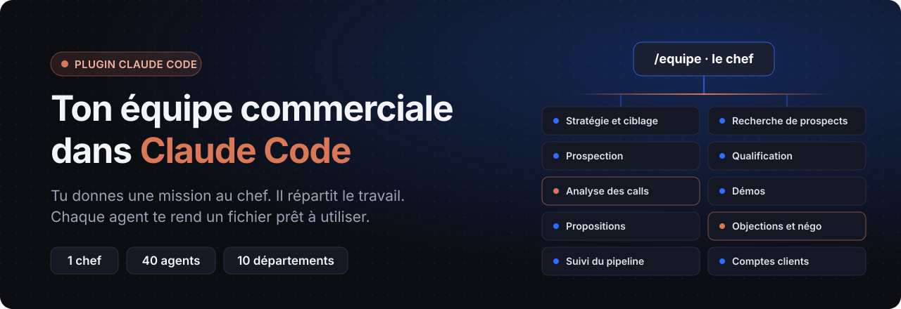
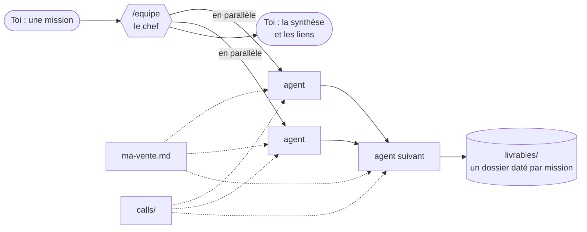

<p align="center">
  
</p>

<p align="center">
  <a href="LICENSE"></a>
  
  
  
</p>

<p align="center">
  <b>Une équipe commerciale complète, installée en 2 minutes.</b><br>
  Tu donnes une mission au chef. Il répartit le travail entre 40 agents spécialisés.<br>
  Chacun te rend un fichier prêt à utiliser : un brief, une liste de prospects, une relance, une proposition…
</p>

<p align="center">
  <a href="#avant-tout--tes-calls">Tes calls</a> ·
  <a href="#installation">Installation</a> ·
  <a href="#le-chef-apprend-à-te-connaître">Ton profil</a> ·
  <a href="#branchée-sur-tes-outils">Tes outils</a> ·
  <a href="#les-4-missions">Les 4 missions</a> ·
  <a href="#ce-que-tu-peux-lui-demander">Ce que tu peux demander</a> ·
  <a href="#lorganigramme">L'organigramme</a> ·
  <a href="#comment-ça-marche">Comment ça marche</a> ·
  <a href="exemples/">Exemples</a>
</p>

---

## Avant tout : tes calls

Trouver les bons prospects, leur écrire, préparer un call, répondre à une objection, relancer : tout repose sur **ce que tes clients disent vraiment pendant tes appels**. Leurs vraies douleurs, leurs vrais besoins, leurs vrais mots.

Sans transcriptions, l'équipe travaille sur des suppositions. Avec, elle travaille sur des faits.

Le plus simple : l'extension Chrome **[Weecloz](https://www.weecloz.io)**. Elle enregistre tes calls sur Google Meet, Zoom et Teams, **sans bot dans ta réunion**. Après le call : onglet Transcript → Copier le transcript, et tu le colles dans la conversation. Le chef le range dans `calls/`.

> N'importe quelle transcription marche aussi, du moment qu'elle contient les noms des interlocuteurs. Pense à prévenir ton prospect que tu enregistres.

## Installation

Il te faut un abonnement Claude qui donne accès à **Claude Code**, et l'app Claude sur ton ordinateur. Pas besoin de terminal.

1. Crée un dossier `Ma vente` sur ton ordinateur.
2. Ouvre l'app Claude, onglet **Code**, et démarre une session dans ce dossier.
3. Tape ces deux commandes, l'une après l'autre :

   ```
   /plugin marketplace add weecloz/equipe-commerciale
   /plugin install equipe@weecloz
   ```

4. Tape `/equipe` (ou `/equipe:equipe` si la première forme ne répond pas).

## Le chef apprend à te connaître

Une équipe qui ne connaît ni tes cibles, ni tes outils, ni tes messages qui marchent écrit des messages génériques. Et un message générique ne reçoit pas de réponse. Alors le chef commence par te connaître.

**Au premier lancement (10 minutes, une question à la fois)** : toi, ton offre et tes preuves, tes 1 à 3 cibles (avec l'intitulé exact des décideurs), tes concurrents, **tes outils connectés**, ton style.

**Puis au bon moment**, la première fois qu'une mission en a besoin : tes 3 à 5 messages de prospection qui ont eu des réponses (avant la 1re prospection), ton export CRM (avant la 1re relance), tes transcriptions (avant la 1re analyse de calls). Rien n'est demandé pour rien, rien n'est demandé deux fois.

Tout est rangé dans ton dossier, en fichiers simples que tu peux modifier :

```
ma-vente.md              ton offre, tes preuves, ton style
mes-cibles.md            tes cibles : intitulés exacts, douleurs, déclencheurs, « ne pas viser »
mes-outils.md            tes outils connectés et ce que l'équipe en fait
messages-qui-marchent/   gagnants.md et flops.md
calls/                   tes transcriptions
livrables/               un dossier daté par mission
```

## Branchée sur tes outils

Si tes outils sont connectés à Claude Code, l'équipe s'en sert :

| Outil | Ce que fait l'équipe |
|---|---|
| **Enrichissement** (FullEnrich, Dropcontact, Kaspr, Lusha…) | trouve l'email et le téléphone des décideurs, avec leur statut (vérifié, risqué) |
| **CRM** (HubSpot, Pipedrive, folk, Salesforce…) | lit tes contacts et tes deals ; crée les contacts, notes et tâches **après ton accord** |
| **Mail** (Gmail, Outlook) | crée des brouillons **après ton accord** ; n'envoie jamais |
| **Séquences** (lemlist, La Growth Machine…) | lit les statistiques de tes campagnes ; charge une séquence **en pause** après ton accord |

**Lire librement, écrire jamais sans toi.** Chaque écriture dans un outil passe par un fichier `actions-a-valider.md` : le chef te montre la liste, tu réponds « oui », « oui sauf 3 » ou « non », et il exécute seulement ce que tu as validé. Un outil pas connecté ? L'équipe le dit et continue sans : elle ne devine jamais un email.

## L'équipe apprend

Dis simplement au chef « Julie a répondu à ce message » ou « cette séquence a fait un flop ». Il range le message dans `gagnants.md` ou `flops.md`, avec la cible et le résultat. Avant chaque rédaction, les agents relisent tes gagnants pour la cible visée et écrivent sur leur modèle.

## Les 4 missions

| Tu tapes | Le chef lance | Tu reçois |
|---|---|---|
| « Prépare mon call avec Sarah » | fiche compte + objections passées → prépa de call | un brief de 2 minutes : le rappel de vos échanges, 5 questions, 2 objections probables avec la réponse, l'objectif du call · [exemple](exemples/1-prepa-call.md) |
| « Trouve-moi de nouveaux clients » | portrait client → comptes → décideurs + déclencheurs → accroches → emails + LinkedIn | des comptes réels, chacun avec sa source, et ta liste d'envoi du jour · [exemple](exemples/2-nouveaux-clients.md) |
| « Relance mes deals qui dorment » | rapport pipeline → une relance par deal | les deals qui dorment (depuis ton export CSV) et leur relance écrite · [exemple](exemples/3-deals-qui-dorment.md) |
| « Aide-moi à augmenter mon taux de closing » | temps de parole + objections + qualif sur chaque call → autopsie | les 3 freins qui reviennent, avec citations, et quoi changer · [exemple](exemples/4-taux-de-closing.md) |

## Ce que tu peux lui demander

Parle normalement : le chef choisit les bons agents et te dit lesquels.

**Stratégie et ciblage**
- « Aide-moi à définir ma cible : à qui je dois vraiment écrire ? »
- « Quels sont les 3 segments où j'ai le plus de chances de signer ce trimestre ? »
- « Compare-moi à mes 4 concurrents : offre, prix publics, où je gagne »
- « Écris mon message pour les DAF de PME industrielles »

**Recherche de prospects**
- « Trouve-moi 20 PME de la région lyonnaise qui recrutent des commerciaux »
- « Trouve les cabinets d'architectes de Bordeaux qui ont ouvert une agence cette année »
- « Qui décide chez Nova, et comment je le joins ? »
- « Fais-moi la fiche de Boulangeries Martin avant mon call de demain »

**Prospection**
- « Écris une séquence de 3 emails pour les DRH de PME de 50 à 200 personnes »
- « Prépare mes invitations LinkedIn et mes premiers messages pour ces 15 comptes »
- « Réécris ce mail de prospection, il ne reçoit aucune réponse »
- « Prépare ma liste d'envoi du jour »

**Qualification**
- « Classe-moi ces 40 leads : par qui je commence ? »
- « Remplis ma grille BANT avec mon call d'hier »
- « Quelles questions je dois poser à Julie pour savoir si c'est sérieux ? »
- « Ce deal vaut-il encore le coup ? »

**Calls**
- « Prépare mon call de 14 h avec Sarah »
- « Résume mon call avec Nova et dis-moi ce qu'on s'est promis »
- « Est-ce que j'ai trop parlé ? »
- « Il est chaud ou pas ? »

**Démos et propositions**
- « Prépare ma démo pour Nova à partir de notre call de découverte »
- « Fais-moi répéter ma démo : joue le prospect »
- « Écris la proposition pour Nova »
- « Calcule le ROI avec les chiffres qu'il m'a donnés »
- « Fais un résumé d'une page pour son associé, qui n'était pas au call »

**Objections et négociation**
- « Qu'est-ce que j'aurais dû répondre quand il a dit "c'est trop cher" ? »
- « Prépare ma négo : il veut 15 % de remise »
- « Entraîne-moi sur ses objections avant le call de jeudi »

**Pipeline et clients**
- « Fais mon rapport du lundi »
- « Relance mes deals qui dorment »
- « Pourquoi je perds mes deals ? »
- « Prépare l'onboarding de mon nouveau client »
- « Mon client ne répond plus depuis 3 semaines : il risque de partir ? »
- « Quand est-ce que je peux lui demander une recommandation ? »

## L'organigramme

| Département | Agents |
|---|---|
| **1. Stratégie et ciblage** | `strategie-portrait-client` · `strategie-segments` · `strategie-message` · `strategie-concurrence` |
| **2. Recherche de prospects** | `recherche-comptes` · `recherche-decideurs` · `recherche-declencheurs` · `recherche-fiche-compte` |
| **3. Prospection** | `prospection-email` · `prospection-linkedin` · `prospection-sequence` · `prospection-accroches` |
| **4. Qualification** | `qualif-grille` · `qualif-score` · `qualif-questions` · `qualif-disqualifieur` |
| **5. Découverte et analyse des calls** | `decouverte-prepa-call` · `decouverte-analyste-call` · `decouverte-temps-parole` · `decouverte-signaux-achat` |
| **6. Démos** | `demo-scenario` · `demo-preuves` · `demo-repetition` · `demo-debrief` |
| **7. Propositions** | `propo-redacteur` · `propo-roi` · `propo-resume-decideur` · `propo-relecteur` |
| **8. Objections et négociation** | `nego-detecteur-objections` · `nego-dis-plutot` · `nego-preparation` · `nego-simulateur` |
| **9. Suivi du pipeline** | `pipeline-notes-crm` · `pipeline-relanceur` · `pipeline-rapport` · `pipeline-autopsie` |
| **10. Comptes clients** | `comptes-onboarding` · `comptes-sante` · `comptes-upsell` · `comptes-recommandation` |

Le détail de chaque agent (ce qu'il fait, ce qu'il lit, ce qu'il écrit) est dans [`skills/equipe/organigramme.md`](skills/equipe/organigramme.md).

## Comment ça marche



- **Le chef** (`skills/equipe/`) lit ta demande, choisit les agents dans l'organigramme, annonce son plan en une ligne, lance les agents (jusqu'à 5 en même temps) et te rend une synthèse courte.
- **Chaque agent** (`agents/`) a un seul job et un format de sortie fixe. Les agents de stratégie et de recherche ont le web ; ceux qui travaillent avec tes outils (recherche, qualification, pipeline, comptes) ont accès à tes connecteurs, en lecture seule ; les autres n'ont que leurs fichiers. Plusieurs s'appuient sur des skills de vente (`skills/`) : prépa de call, détecteur d'objections, temps de parole (compté par un script, pas estimé), relance…
- **Ton dossier de travail** contient tout : ton profil, `calls/` et `livrables/`. Les seules données qui en sortent vont vers tes outils connectés (enrichissement, CRM, séquences), et seulement pour la mission en cours.

## Des messages qui ne sentent pas le modèle

Tous les agents de prospection s'appuient sur le skill `outbound`, écrit pour la vente B2B en France :

- **un signal par message** (recrutement, levée, nomination, nouveaux locaux, manque d'outillage…), daté et sourcé, et toujours **au moins un fait propre au compte** ;
- **un bloc de faits par compte** : les rédacteurs n'affirment rien qui n'y soit pas ;
- **le premier email** : moins de 75 mots, une observation, une seule question, pas de pitch, un objet en minuscules ;
- **LinkedIn** : invitation **sans note**, premier message après l'acceptation, sans lien ni pitch ;
- **une liste noire** de formules (« je me permets », « n'hésitez pas », « booster »…) ;
- **un script contrôle chaque message de prospection** avant que tu le voies : longueur, une seule question, mots interdits, objet, invitation sans note, et deux messages d'une même liste qui se ressemblent trop.

## Les règles de toute l'équipe

- **Rien d'inventé.** Chaque info porte sa source : ta fiche, un call (avec la minute), une page web (avec l'adresse) ou ton CRM. Sinon, c'est écrit « à vérifier ».
- **Des citations mot pour mot**, au format `[mm:ss] « phrase exacte »`.
- **Rien n'est envoyé à ta place.** L'équipe prépare les messages, tu les envoies.
- **Tes outils** : lus librement, jamais modifiés sans ton accord.

> **LinkedIn** : Claude Code peut piloter un navigateur, mais LinkedIn interdit l'automatisation et restreint les comptes qu'il repère. Envoie toi-même avec ta liste d'envoi du jour. Si tu automatises quand même, c'est sous ta responsabilité.

> **Délivrabilité** : prospecte depuis un domaine dédié (SPF, DKIM, DMARC), chauffé 2 à 4 semaines, 20 à 50 emails par boîte et par jour au plus, uniquement vers des adresses vérifiées.

## Structure du dépôt

```
.claude-plugin/     manifeste du plugin et marketplace « weecloz »
skills/equipe/      le chef : SKILL.md, organigramme, missions, entretien
skills/outbound/    le savoir de prospection en français et le script de contrôle des messages
skills/…            les 10 skills de vente et les modèles (proposition, séquence, onboarding, liste d'envoi)
agents/             les 40 agents, un fichier par agent
exemples/           une réponse réelle (anonymisée) pour chaque mission
```

## Licence

[MIT](LICENSE). Utilise-la, modifie-la, partage-la.

<p align="center"><sub>Fait par <a href="https://www.weecloz.io">Weecloz</a> · l'extension qui enregistre et analyse tes calls de vente, sans bot.</sub></p>
